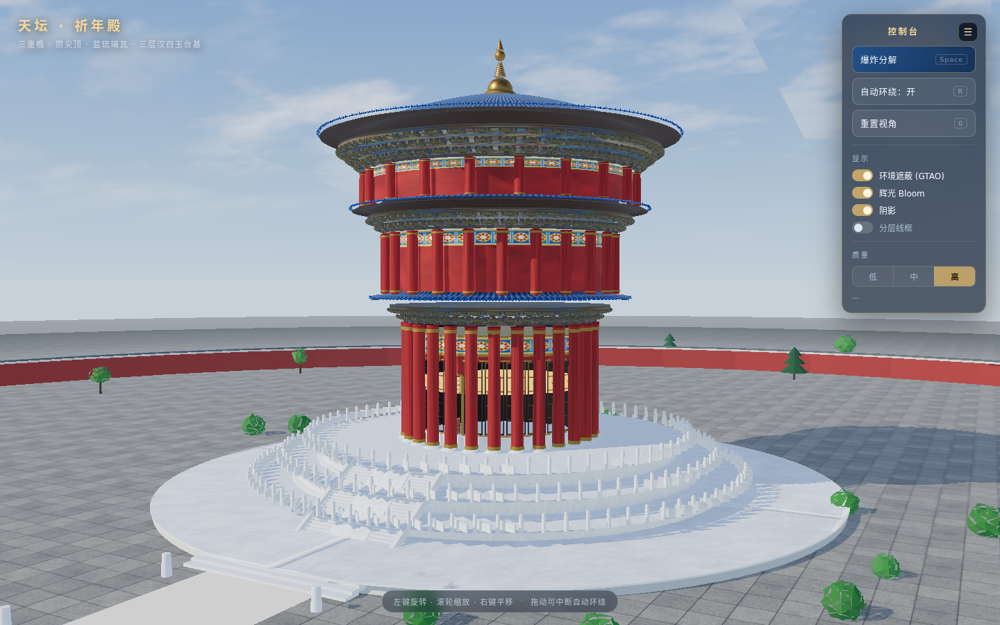
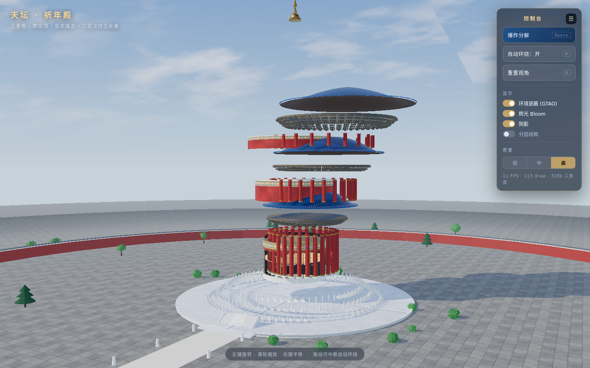

# 天坛 · 祈年殿 — 程序化 WebGL 重建

[](https://bill-666code.github.io/tiantan-webgl-MiniMax-M3.1-Flash-Preview/)
[](https://github.com/Bill-666code/tiantan-webgl-MiniMax-M3.1-Flash-Preview/actions)
[](https://threejs.org/)

## ▶ 在线试玩

**直接点击 → [https://bill-666code.github.io/tiantan-webgl-MiniMax-M3.1-Flash-Preview/](https://bill-666code.github.io/tiantan-webgl-MiniMax-M3.1-Flash-Preview/)**

无需安装、无需构建、无需服务器，浏览器打开即可交互（拖拽旋转 / 滚轮缩放 / 空格爆炸分解 / R 自动环绕 / 0 重置视角 / W 线框）。
仓库右上角 `About → Website` 也已挂上该链接。

> 首次打开需 1–2 秒生成全部几何与贴图（进度条可见），之后可流畅交互。

> TypeScript + Three.js。**全部建筑几何、纹理、动画在运行时由代码生成**，
> 不加载任何 `.glb / .gltf / .obj / .fbx` 模型或图片、HDRI 贴图（源码中不存在任何
> `GLTFLoader / OBJLoader / TextureLoader / fetch` 调用，纹理全部由 Canvas2D 现算）。



> 爆炸分解视图：屋顶 / 斗拱 / 柱圈 / 鼓座 / 墙体 / 栏杆 / 台基逐层错峰散开



---

## 1. 快速开始

**在线**：<https://bill-666code.github.io/tiantan-webgl-MiniMax-M3.1-Flash-Preview/>

**本地**：

```bash
cd tiantan-webgl
npm install          # 安装依赖（three / vite / typescript）

npm run dev          # 开发模式 → http://127.0.0.1:5173
npm run build        # 类型检查 + 生产构建 → dist/
npm run preview      # 预览生产构建 → http://127.0.0.1:4173
```

要求：Node.js ≥ 18，浏览器需支持 **WebGL 2**（Chrome / Edge / Firefox / Safari 16+）。
首次进入会有约 1–2 秒的程序化生成过程，带加载进度条。

## 2. 操作

| 操作 | 说明 |
| --- | --- |
| 左键拖拽 | 轨道旋转 |
| 滚轮 / 双指 | 缩放 |
| 右键拖拽 | 平移 |
| **空格** / 「爆炸分解」 | 屋顶、柱子、斗拱、墙体、门窗、栏杆、台基按层次错峰散开；再次触发精确归位 |
| **R** / 「自动环绕」 | 开关缓慢自动环绕（用户操作后暂停 4 秒自动恢复） |
| **0** / 「重置视角」 | 回到默认机位 |
| **W** / 「分层线框」 | 线框模式，便于观察层次与构件 |
| 「环境遮蔽 / 辉光 / 阴影」 | 逐项开关后处理 |
| 「低 / 中 / 高」 | 画质档位（影响像素比、阴影分辨率、GTAO/辉光、屋顶细分、树木数量） |

响应式：窗口缩放自适应；竖屏 / 手机会自动加大视野并把爆炸取景拉远，面板可折叠。

## 3. 建筑还原要点

尺度参考公开资料（**总高约 38 m、上层檐口直径 32.72 m、28 根檐柱、三层汉白玉台基**）做了比例化重构，
部分构件（如斗拱、栏杆密度）为观感做了适度夸张。

- **三重檐 · 攒尖顶，上大下小**：这是祈年殿区别于一般楼阁的体量关系。
  - 上檐 ⌀32.7 m（檐口 y=32.1）→ 中檐 ⌀27.2 m（y=25.5）→ 下檐 ⌀23.8 m（y=17.3）
- **曲线屋顶（非圆锥）**：剖面由 `src/build/roofProfile.ts` 求得 ——
  `θ(t) = k·(ρ − (ρ−1)(1−t)^1.55)` 的举折曲线，用二分法同时匹配水平跨度与高度，
  末端 26% 再叠加**檐口起翘 + 外撇**，得到舒展微翘的檐口；剖面绕轴旋转成面。
  上下双层壳体 + 檐口/内缘封边，任意角度都是实体。
- **瓦垄**：法线贴图表现盖瓦/底瓦的半圆起伏与瓦垡搭接，一张贴图覆盖 4 垄 × 8 垡；
  重复次数直接烘焙进 UV，三重屋顶共用同一材质。檐口另有 **瓦当 / 滴水** 实例化构件。
- **鎏金宝顶**：宝座 → 覆钵 → 相轮 → 宝珠 → 火焰尖，全部 Lathe/Cone 旋转体。
- **红色柱廊**：28 根檐柱带收分（卷杀），柱础、描金箍头为独立实例。
- **蓝绿金彩画**：`caissonTexture()` 程序化绘制旋子彩画（箍头 + 回纹 + 旋子 + 藻头），
  按构件实际周长设置 UV 重复，长条环面上不变形。
- **门窗**：墙体是一整张圆筒，用 `alphaMap` 在门窗位置真实开洞，洞后是暗色内壁；
  门窗为步步锦棂格（Canvas 绘制，含 alphaTest），正南北东西设槅扇门。
- **斗拱**：栌斗 → N 层「三跳拱 + 小斗」→ 外挑昂，按类型合并为 InstancedMesh，
  另有檐檩、垫板、柱头枋；整圈仅 5 个 draw call。
- **三层汉白玉台基**：须弥座式旋转体（地伏/下枭/束腰/上枭/挑出压顶），
  中央三跑踏跺 + 雕刻御路 + 垂带 + 螭首；每层设望柱与栏板（台阶处断开）。

## 4. 场景与渲染

- **天空**：自定义着色器天穹（天顶蓝 → 地平线白、太阳盘与辉光、fbm 云层），
  同一片天空用 `PMREMGenerator` 烘成环境贴图，鎏金与琉璃因此有真实反射。
- **光照**：`DirectionalLight`（投影，3072² 阴影贴图，紧贴建筑的正交视锥）
  + `HemisphereLight`（地面反照决定檐底亮度）+ 弱 `AmbientLight`；
  `FogExp2` 模拟北京秋日晴空能见度。
- **后处理**：`EffectComposer`（HalfFloat + MSAA）→ `GTAOPass`（环境遮蔽）
  → `UnrealBloomPass`（微弱辉光）→ `OutputPass`（ACES Filmic + sRGB）。
- **性能**：
  - 重复构件全部实例化（斗拱 3 圈、柱圈、望柱栏板、瓦当、树木…）
  - 高画质约 **100 draw call / 33 万三角面**（实测，控制台实时显示）
  - 阴影贴图仅在场景变动时重算（静止后自动停止）
  - 三档画质 + FPS 自适应降级（连续过慢时自动降一档并提示）
  - 屋面 / 鼓座 / 墙体用旋转体与共享材质，减少状态切换

## 5. 目录结构

```
src/
├── config.ts              # 全部尺寸、配色、画质、动画参数（改这里即可调形制）
├── core/
│   ├── App.ts             # 渲染器 / 相机 / 控制器 / 后处理 / 画质 / 帧循环
│   ├── sky.ts             # 天穹着色器 + 光照 + PMREM 环境贴图
│   └── ground.ts          # 广场铺地、月台、院墙、甬道
├── gfx/
│   ├── noise.ts           # 值噪声 / fbm / 山脊噪声
│   ├── textures.ts        # 全部程序化贴图（瓦、石、彩画、棂格、漆、金、木、云…）
│   └── materials.ts       # 共享材质库 + 按尺寸铺装的环形材质
├── build/
│   ├── roofProfile.ts     # 举折曲线求解（二分法）
│   ├── roof.ts            # 屋顶壳体几何 + 檐口瓦当滴水
│   ├── dougong.ts         # 斗拱（实例化）
│   ├── columns.ts         # 柱圈 / 鼓座
│   ├── body.ts            # 殿身墙体 + 槅扇门 + 窗
│   ├── terrace.ts         # 台基 / 踏跺 / 御路 / 栏杆
│   ├── finial.ts          # 鎏金宝顶
│   ├── trees.ts           # 松 / 槐 / 灌木（实例化）
│   └── Assembly.ts        # 分层装配 + 爆炸位移定义
├── anim/ExplodeController.ts   # 错峰时间轴动画
└── ui/hud.ts              # 面板、快捷键、统计
```

## 6. 扩展方式

- **改形制**：编辑 `src/config.ts` 中 `BUILDING.levels`（檐口半径/高度、内缘、柱圈、斗拱层数、瓦垄数）即可，
  三重檐由数组驱动，增减层数不需要改其它代码。
- **改配色**：`PALETTE` + `textures.ts` 里的 HSL 参数。
- **加构件**：在 `build/` 下新增返回 `THREE.Group` 的函数，在 `Assembly.ts` 里
  `layers.push({ id, label, object, offset, twist })` 即可自动参与爆炸动画
  （错峰顺序 = `layers` 数组顺序）。

## 7. 验证情况（如实说明）

**已验证：**

- `npx tsc --noEmit` 与 `npm run build` 均通过，无类型错误、无构建告警。
- 生产构建与开发服务器均能启动并正常渲染（headless Chrome + SwiftShader 软件渲染）。
- 多机位截图核对：默认视角、仰视檐口、俯瞰屋顶、柱身/栏杆/御路特写、全景院落。
- **爆炸 / 重组**：逐层散开与逐层归位正确；归位后各层 position 精确回到原值
  （探针校验：屋顶、柱圈、墙体、宝顶 offset 均为 0 误差）。
- 交互：自动环绕、分层线框、GTAO/辉光/阴影开关、三档画质切换、面板折叠、
  重置视角、空格/R/0/W 快捷键、按钮文案与状态同步 —— 均通过，控制台无报错。
- 竖屏（414×820）与桌面双尺寸下布局与取景正常。
- 构建产物仅 `index.html + 1 个 JS + 1 个 CSS`（three 单独分块，gzip 144 kB），
  无任何外部模型/贴图文件。

**未验证 / 已知限制：**

- **真实 GPU 帧率未实测**：验证环境只有 SwiftShader 软件渲染（实测 0.2–11 FPS，
  视视角而定），无法代表桌面独显/核显的真实性能。控制台显示的 draw call 与
  三角面数（≈100 / 33 万）是实测值，可作为性能参考。
- **FPS 自适应降级**逻辑已实现且会在触发时提示，但因为软件渲染本身极慢，
  该路径只做了代码级检查，未在真实硬件上验证阈值表现。
- 建筑尺寸为依据公开数据的比例化重构，非测绘级复原；斗拱、栏杆等细部做了简化。
- 室内仅用暗色内壁 + 微弱暖光示意，未建藻井 / 神像 / 陈设。
- 未做多端真机测试（仅用 Chrome 模拟了移动端视口，未在真实手机浏览器上验证）。

## 8. 许可

代码可自由用于学习与创作。如需商用请自行确认。
